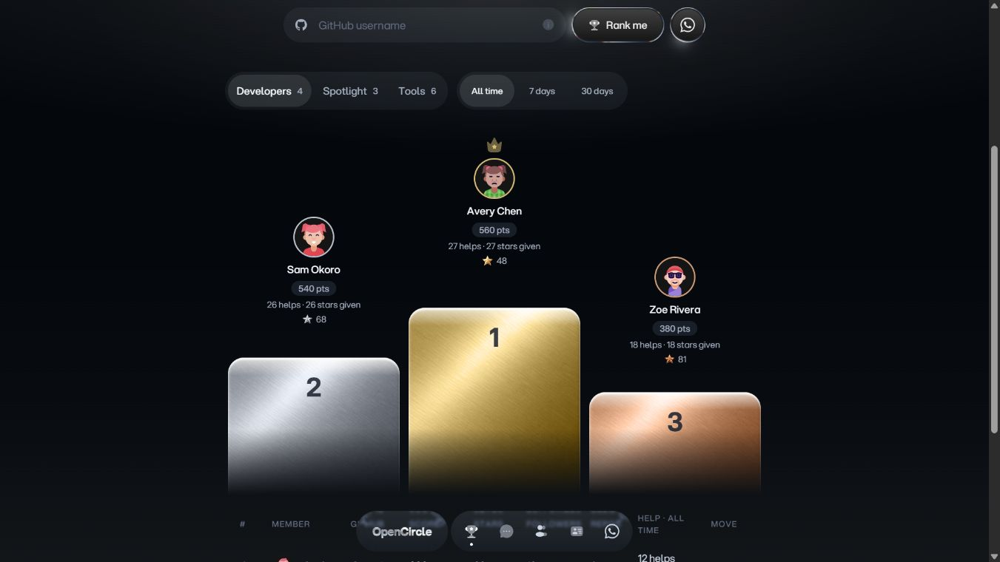

# Podium materials

These original assets were generated with OpenAI's built-in image generation tool for the metallic leaderboard podium contribution on 2026-10-17. The selected Satin Metal design concept was used as the style reference. No runtime service or new dependency is required.

- `brushed-metal.webp`: 640 × 640 grayscale satin metal material, shared across all three rank finishes with CSS color blending. Prompt: full-bleed front-facing brushed silver surface, fine diagonal hairlines, broad soft specular highlights, darker lower-right; no text, objects, edges or framing. Downsampled and encoded as WebP.
- `star-gold.png`: 96 × 96 transparent champagne gold star.
- `star-silver.png`: 96 × 96 transparent pearl silver star.
- `star-bronze.png`: 96 × 96 transparent copper bronze star.

Star prompt, with the corresponding metal substituted: single centered upright five-point star with polished beveled facets and subtle realistic highlights; transparent exterior and approximately 8% padding; no glow, particles, text or backing coin. Each star was generated separately, then downsampled with its alpha preserved for display at 14–16 CSS pixels.

All four assets total approximately 74 KB. Stars are decorative: the component keeps rank numbers and accessible labels as text. Existing repository secondary icons remain unchanged.

The follow-up builds on the existing medal palette and current-user outline. Preview with fictional members:

